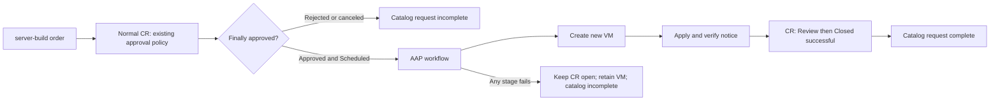

# Approval-driven standard server builds

The `server-build` ServiceNow catalog item requests a new RHEL 9 or Windows Server 2022 VM on OpenShift Virtualization. A normal change request (CR) must receive final authorization before AAP creates any resources. The initial baseline is an ownership notice; this build does not install requester-selected packages.



## Deploy

Use the repository's existing CasC environment and collections (`infra.aap_configuration`, `ansible.controller`, `kubernetes.core`, and the certified `redhat.openshift_virtualization` collection). The runtime Windows EE must include `ansible.windows` and `pywinrm`; the RHEL EE must include the Kubernetes and OpenShift Virtualization collections. Publish the existing execution environments before deployment.

Prerequisites:

- Log in to OpenShift with `oc`. The rollout discovers AAP's route and admin password from the current cluster. Override `aap_hostname`, `aap_username`, and `aap_password` through your normal Ansible credential mechanism when needed.
- Configure an active ServiceNow group and an existing normal-change approval policy for that group. The policy must advance an assessed request through final authorization to Scheduled; an intermediate approval alone does not launch a build. The integration does not provision approval routing or automatically approve requests.
- The ServiceNow deployment account needs access to integration metadata, dictionary definitions, catalog items, rules, REST messages, and properties. Its runtime account must read/write the linked CR and RITM, including the integration tracking fields, and perform Implement → Review → Closed transitions. Instance-required approval tasks and closure checks must allow automation to complete this sequence.
- Provide a RHEL SSH keypair matching `openshift_virt_aap_vm_ssh_private_key_file` and `openshift_virt_aap_vm_ssh_public_key_file`. A dedicated AAP Machine credential uses this key as `cloud-user`, matching the RHEL cloud-init user.
- Provide a prepared Windows golden DataVolume with working WinRM/NTLM on port 5985, accessible from the Windows EE. Its Administrator password must match the managed Windows credential. Existing namespace, image preparation, and network prerequisites still apply.

The top-level deployment also loads an optional, git-ignored `user.creds.yml`. It accepts
`snow_instance`, `snow_username`, `snow_password`, `windows_username`, and `windows_password`.
Guest SSH keys and other non-secret overrides still come from the variables file.

Alternatively, set these environment variables securely:

- `SNOW_INSTANCE`, `SNOW_USERNAME`, `SNOW_PASSWORD`
- `SERVER_BUILD_WINDOWS_PASSWORD` — the password already configured on the golden image
- Optional `CONTROLLER_USERNAME` — defaults to `admin` for this deployment

Create a non-secret variables file, for example:

```yaml
snow_server_build_assignment_group: 0123456789abcdef0123456789abcdef
openshift_virt_aap_vm_ssh_private_key_file: /absolute/path/to/private_key
openshift_virt_aap_vm_ssh_public_key_file: /absolute/path/to/public_key
openshift_virt_aap_server_build_windows_golden_dv: windows-server-os-work
```

Then run from the repository root:

```bash
ansible-playbook server-build-deploy.yml -e @server-build.vars.yml
```

The launcher uses `openshift_virt_aap_server_build_only: true`, a separate AAP project and ServiceNow credential, and skips unrelated demo templates, schedules, portal users, and guest credentials. This deploys the AAP jobs, two workflows, and managed guest credentials first, then deploys only the new catalog item and approval rules. It preserves the existing immediate-launch catalog rule, REST endpoint, Script Include, and authentication properties. Approval-only deployment uses a separate `AAP Server Build` REST message, `AAPServerBuildIntegration` Script Include, and `aap.server_build.api.*` properties. It does not require unrelated AWS provisioning workflows. The standalone catalog playbook can also be used after AAP deployment:

```bash
ansible-playbook jt_playbooks/snow/catalog_deploy_updateset.yml \
  -e snow_server_build_enabled=true -e snow_server_build_only=true \
  -e @server-build.vars.yml
```

For the standalone command, also supply `CONTROLLER_HOST`, `CONTROLLER_USERNAME`, and `CONTROLLER_PASSWORD`. General CasC deployments leave the new feature disabled unless `openshift_virt_aap_server_build_enabled` is enabled explicitly.

## Configure the baseline

| Variable | Default |
| --- | --- |
| `openshift_virt_aap_server_build_banner_title` | `United States Government System` |
| `openshift_virt_aap_server_build_banner_text` | `This system is owned by the United States Government. Access is restricted to authorized users. Use may be monitored.` |
| `openshift_virt_aap_server_build_windows_golden_dv` | `windows-server-os-work` |
| `openshift_virt_aap_server_build_windows_username` | `Administrator` |
| `openshift_virt_aap_server_build_rhel_username` | `cloud-user` |
| `openshift_virt_aap_server_build_snow_validate_certs` | `true` |
| `openshift_virt_aap_server_build_vm_wait_timeout` | `1800` seconds (RHEL creation, including initial cloud disk cloning) |
| `snow_server_build_planned_duration_minutes` | `60` |

Use your organization's approved wording. RHEL manages `/etc/motd` as root, mode `0644`. Windows manages `legalnoticecaption` and `legalnoticetext` under `HKLM:\SOFTWARE\Microsoft\Windows\CurrentVersion\Policies\System`. Both platforms read the settings back before reporting success. After verification, the workflow closes active implementation and testing child tasks with the build evidence before closing the parent change. Any other active child task requires operator review. Guest passwords are injected by an AAP custom credential through environment variables and are never stored on the form, CR, or workflow artifacts.

The catalog form collects OS, VM name (a lowercase DNS label, maximum 63 characters), and instance size. Namespaces come from the existing RHEL and Windows role defaults. Image sources and baseline settings are administrator-controlled. Builds start immediately after final authorization; planned dates provide change planning context and do not implement maintenance-window scheduling.

## Cloud disk cloning

Large imported disks on EBS can take a long time to produce their first snapshot. A cluster administrator can select host-assisted cloning for a storage class when that fits the environment:

```bash
oc patch storageprofile gp3-csi --type=merge -p '{"spec":{"cloneStrategy":"copy"}}'
```

This setting applies to all clones using that storage class. CDI copies data through source and target pods instead of waiting for an initial cloud snapshot. See the [OpenShift storage documentation](https://docs.redhat.com/en/documentation/openshift_container_platform/4.20/html/virtualization/storage) for the available strategies. Confirm the cluster's strategy and clone duration before choosing workflow timeouts.

## Operations and recovery

The CR stores `u_aap_integration`, `u_aap_build_parameters`, `u_aap_launch_status`, and `u_aap_workflow_job_id`. Its parent and correlation ID identify the originating RITM. The input snapshot and integration identity cannot be edited after creation; submit a new order to change them.

Launch status progresses from `pending` to `launching` to `launched`. Rejections/cancellations before dispatch become `canceled`. Explicit API rejections become `failed`; timeouts, server errors, or malformed launch responses become `unknown`. Repeated note/state updates do not redispatch, and resetting the status to `pending` is blocked. For `unknown` or a stranded `launching` status, inspect AAP jobs for the CR sys_id before taking recovery action; a job may already exist. There is no automatic retry of an ambiguous launch.

VM or disk name collisions fail without adopting existing resources. Failures retain any created VM and add the failed stage and AAP link to the change and catalog request. Fix the cause and inspect retained resources before submitting a replacement order. If change closure fails, the catalog item remains incomplete; resolve the instance policy or permissions issue before manually completing the change. If CR closure succeeded but the subsequent RITM update failed, the CR remains closed and the workflow reports failure for operator reconciliation.

A server-build-only deployment preserves the existing network configuration rule's script and adds an exclusion for server-build changes. A full catalog deployment scopes the repository's network rule to `correlation_display=network-configuration`; both network CR creation playbooks set that marker. For a pre-existing demo network change under that full deployment, set the marker before moving it to Implement.

To stop new orders, deactivate the `server-build` catalog item. To stop approved requests from dispatching, also deactivate `AAP - Claim Approved Server Build` and `AAP - Launch Approved Server Build`. Preserve the tracking fields for audit and reconcile any in-flight jobs first.

## Validate

Run the local regression suite (Python, PyYAML, Ansible, and Node.js required):

```bash
PYTHONDONTWRITEBYTECODE=1 python -m unittest discover -s tests -p 'test_server_build.py' -v
```

It executes the generated JavaScript against a GlideRecord test double and runs the actual lifecycle playbooks against a local Table API double. It checks approval ordering, rejected/canceled requests, replay suppression, API failure handling, shared XML/API rule definitions, catalog choices, graph wiring, state transitions, child-task completion, and closure failures.

Before enabling access to requesters, validate on the target instance: submit one order per OS; confirm no VM exists while awaiting approval; complete the configured final approval; verify the guest notice, CR closure, RITM completion, and workflow links. Also exercise a name collision and a refused closure. Reapply the baseline jobs with the same artifacts to confirm no registry or MOTD changes on the second run. Local doubles cannot verify instance-specific approval policies, ACLs, golden images, or guest network access.

### Live validation: 20 October 2026

Validated against the supplied ServiceNow instance and ROSA cluster `rosa-hv798`, using the public deployment entry point and an isolated AAP project containing the local checkout.

| OS | VM | Change | AAP workflow | Result |
| --- | --- | --- | --- | --- |
| RHEL | `sb-rhel-1020-165721` | `CHG0030506` | `19` | Successful |
| Windows | `sb-windows-1020-171239` | `CHG0030507` | `25` | Successful |

Both requests followed the instance's assessment and final authorization approvals. Each workflow created its VM, applied and read back the ownership notice, completed implementation/testing child tasks, closed the CR successfully, and completed the catalog request. Baseline reapplications (jobs `24` and `30`) succeeded without changing the notice. Live rejection, direct launch of an unapproved CR, and existing VM-name collision checks prevented provisioning as expected. The 20 local regression tests passed, and the existing shared ServiceNow integration's authentication, REST endpoint, and Script Include remained unchanged.

The lab uses one `m5zn.metal` worker and OpenShift Virtualization. The prepared Windows image was imported into `virt-windows/windows-server-os-work`; `gp3-csi` uses host-assisted copying to avoid slow initial EBS snapshots. Successful VMs, failed-attempt resources, and the worker were retained for inspection.

The validation project is manual: its source was staged into the controller pods' project directory backed by `emptyDir`. A controller pod restart loses that source. Publish the reviewed changes to a durable SCM project before relying on the deployment beyond this lab validation. The implementation remains uncommitted in the local checkout.
